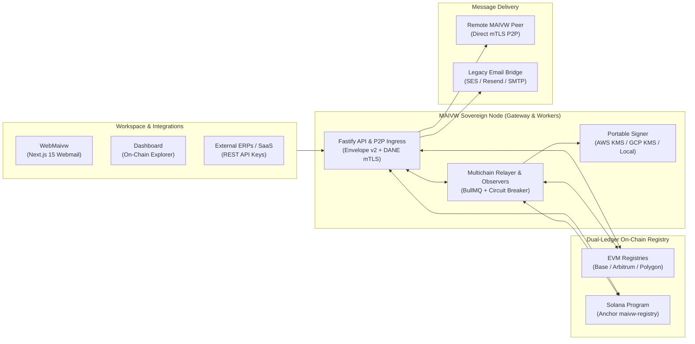

<p align="center">
  <a href="https://maivw.com" target="_blank" rel="noopener noreferrer">
    
  </a>
</p>

<h1 align="center">MAIVW Protocol</h1>

<p align="center">
  <strong>Mathematical Authenticated Identity &amp; Verifiable Workspace</strong>
</p>

<p align="center">
  The open multichain protocol for sovereign corporate communication — combining on-chain identity anchoring across <strong>EVM (Base, Arbitrum, Polygon)</strong> and <strong>Solana</strong>, DANE mTLS peer-to-peer transport, and seamless hybrid SMTP interoperability.
</p>

<p align="center">
  🌐 <strong>English</strong> | <a href="README.pt-BR.md">Português (Brasil)</a>
</p>

<p align="center">
  <a href="https://docs.maivw.com"></a>
  <a href="https://app.maivw.com"></a>
  <a href="https://www.youtube.com/watch?v=nizLF3wB8TM"></a>
  <a href="https://donate.stripe.com/cNi7sKeUIb5P96deZk2kw00"></a>
</p>

<p align="center">
  
  
  
  
  
  
  
  <a href="LICENSE"></a>
</p>

---

## 🎬 Video Overview

Watch how MAIVW replaces fragile legacy email trust with verifiable on-chain identity and cryptographic peer-to-peer routing:

<p align="center">
  <a href="https://www.youtube.com/watch?v=nizLF3wB8TM" target="_blank" rel="noopener noreferrer">
    
  </a>
</p>

<p align="center">
  ▶️ <strong><a href="https://www.youtube.com/watch?v=nizLF3wB8TM">Watch in English (YouTube)</a></strong> &nbsp;|&nbsp;
  🇧🇷 <strong><a href="https://www.youtube.com/watch?v=6uFptIQzlBI">Assistir em Português (YouTube)</a></strong>
</p>

---

## 💡 What is MAIVW?

**MAIVW** stands for **Mathematical Authenticated Identity & Verifiable Workspace**. It is a decentralized corporate communication protocol engineered to give organizations sovereign ownership over their digital identities, domain reputation, and asynchronous messaging:

- **M — Mathematical:** Authorship, integrity, and non-repudiation enforced by deterministic cryptographic proofs (*secp256k1* / *Ed25519*), Merkle intent batches, and the canonical **Envelope v2** wire format.
- **A — Authenticated:** Every message is digitally signed at the origin by the domain's authorized key, mathematically eliminating sender spoofing, phishing impersonation, and in-transit tampering.
- **I — Identity:** Corporate DNS domains are cryptographically anchored to on-chain registries on **EVM (Base, Arbitrum, Polygon)** or **Solana**, removing reliance on centralized authorities.
- **V — Verifiable:** Any node autonomously verifies sender keys, TLS certificate fingerprints (on-chain DANE), economic stake, and reputation status directly against finalized ledger state.
- **W — Workspace:** A complete, self-hostable suite featuring a sandboxed corporate Webmail (`webmaivw`), multi-tenant domain & mailbox administration, and real-time on-chain observability (`dashboard`).

---

## 🎯 The Problem We Solve

Traditional email infrastructure (SMTP/IMAP) was designed in the 1980s without native cryptographic identity or transport guarantees:

1. **Structural Vulnerability to Spoofing & Phishing:** Retrofitted patches (`SPF`, `DKIM`, `DMARC`) are brittle, frequently misconfigured, and lack end-to-end cryptographic non-repudiation and economic accountability.
2. **Gatekeeper Oligopoly & Vendor Lock-in:** A handful of centralized providers control global email deliverability through opaque reputation black boxes and unilateral account suspensions.
3. **Loss of Data Sovereignty:** Organizations pay recurring per-seat fees to store sensitive corporate communications on third-party clouds subject to automated scanning and external jurisdiction.

**MAIVW** turns business communication into an open, cryptographically verifiable peer-to-peer network backed by on-chain economic stake — while maintaining **100% backward compatibility** with legacy email addresses via its hybrid SMTP bridge.

---

## ⚡ How to Join the Protocol

MAIVW is designed for both zero-ops adoption and full infrastructure sovereignty.

### Option 1: MAIVW Cloud (Instant & Fully Managed)
Deploy your domain on the protocol in minutes without managing servers, databases, or RPC nodes:

1. Visit **[app.maivw.com](https://app.maivw.com)**.
2. Verify your corporate domain via a standard DNS `TXT` challenge.
3. Choose your canonical origin network (Base or Solana) and start sending/receiving cryptographically signed messages immediately.

### Option 2: Self-Hosted Sovereign Node (Docker Compose)
Run a complete, independent MAIVW node on your own hardware, VPS, or private cloud.

#### A. Instant Zero-Config Local Stack (Anvil Demo)
Boot the entire protocol locally (Local EVM chain, auto-deployed Registry contracts, PostgreSQL, Redis, Gateway, Webmail, and Dashboard) with a single command:

```bash
# 1. Clone the repository
git clone https://github.com/SilvioSLN/maivw-protocol.git
cd maivw-protocol

# 2. Launch the complete local stack
docker compose up -d --build
```

Once running, access the local interfaces:
- **Observability Dashboard:** `http://localhost:50443`
- **Gateway REST & P2P Node:** `http://localhost:51443`
- **WebMaivw (Corporate Webmail & Admin):** `http://localhost:52443`
- **Local Anvil EVM RPC:** `http://localhost:55443`

> **Demo Admin Invite Token:** Use `local-demo-admin-invite-change-before-testnet-2026` when registering your first administrator account in the local demo.

#### B. Public Testnet / Production Node
To connect your node to public networks (Base Sepolia, Arbitrum Sepolia, Polygon Amoy, and/or Solana Devnet):

```bash
cp .env.testnet.example .env.testnet
cp contracts/deployments/testnets.example.json contracts/deployments/testnets.json
cp solana/deployments/devnet.example.json solana/deployments/devnet.json
```

Configure your RPC endpoints, Registry addresses, HTTPS ingress domains, and isolated secrets in `.env.testnet`, then start the hardened stack:

```bash
docker compose -f compose.testnet.yml --env-file .env.testnet up -d --build
```

See the **[Docker & Self-Hosting Guide](https://docs.maivw.com/users/quickstart-docker/)** for TLS/mTLS, Cloudflare R2/S3, and AWS/GCP KMS signer configuration.

---

## 🧱 Architecture & Components



### Repository Structure

```text
maivw-protocol/
├── contracts/     # Solidity 0.8.28 (Foundry): MAIVWRegistry (UUPS), MAIVWMirrorRegistryV2, Lens & EIP-712/V1 codecs
├── solana/        # Rust / Anchor 1.0: maivw-registry program & maivw-attestation crate (SPL stake, Ed25519/secp256k1)
├── gateway/       # Fastify 5 TypeScript node: P2P mTLS router, Dual-Ledger adapters, BullMQ workers, KMS signers & Prisma
├── webmaivw/      # Next.js 15 sovereign corporate webmail, sandboxed viewer, SSRF-hardened proxy & onboarding wizard
├── dashboard/     # Next.js 15 public notary ("Cartório") explorer, slashing monitor & node telemetry
├── docs/          # Astro Starlight technical documentation & interactive deployment architecture planner
├── specs/         # Formal protocol specifications (StateAttestationV1, multichain origin catalog & wire formats)
└── integration/   # Cross-stack integration helpers and verification scripts
```

---

## 🛡️ Development Stage & Roadmap

MAIVW Protocol is currently in **Public Testnet & Controlled Pilot Rollout**. All core protocol mechanics, dual-ledger synchronization, and cloud runtime hardening are implemented and continuously verified by **446 automated tests**:

### Completed Milestones
- [x] **Canonical Envelope v2 & Replay Defense:** Deterministic signing (`EIP-191` / `Ed25519`) with message class rules (`TX_CODE`, `TX_RECEIPT`, `SUPPORT`, `CONVERSATION`, `MARKETING`, `COLD_OUTREACH`), nonce tracking, and timestamp bounds.
- [x] **On-Chain DANE & mTLS Pinning (S08):** Fail-closed peer-to-peer TLS certificate SHA-256 fingerprint verification anchored directly in `MAIVWRegistry`.
- [x] **Dual-Ledger Multichain Origin & Mirroring (EVM + Solana):** Organizations can register their canonical identity on **Base**, **Arbitrum**, **Polygon**, or **Solana**, with finalized cross-chain state replication via `StateAttestationV1` (`MAIVWMirrorRegistryV2` on EVM and `maivw-registry` PDAs on Solana).
- [x] **Economic Staking, Slashing & Recovery:** On-chain provider tiers, Merkle-proof reporter slashing claims, two-step admin rotation, epoch-bound emergency key recovery, and expired domain reclamation.
- [x] **Production-Grade Runtime Hardening:** Role-separated workers (`api`, `p2p`, `mail-worker`, `oracle-worker`, `relayer-worker`, `evm-indexer`, `solana-indexer`), non-exportable **AWS KMS** (`secp256k1` & `Ed25519`) and **GCP KMS** signers, persistent RPC circuit breakers, S3/R2 object storage, strict multi-tenant isolation, and multi-arch (`linux/amd64`, `linux/arm64`) non-root Docker images.

### Upcoming Roadmap
- [ ] **S07 — End-to-End Payload Encryption (E2EE):** Client-side key agreement and zero-knowledge message body encryption.
- [ ] **External Smart Contract & Anchor Security Audit:** Independent third-party audit of `contracts/` and `solana/programs/maivw-registry` ahead of Mainnet launch.
- [ ] **Decentralized Threshold Oracle Network:** Multi-operator `t-of-n` attestation quorum for trust-minimized cross-chain state relaying.
- [ ] **Mainnet General Availability (GA) & Developer SDKs:** Official Mainnet deployment on Base and Solana alongside publishable `@maivw/sdk` packages.

---

## 🧪 Running the Test Suites

```bash
# 1. Gateway unit & integration suite (254 tests)
cd gateway && pnpm test

# 2. Solana Rust workspace & normative vectors (66 tests)
cd solana && cargo test --workspace --locked

# 3. EVM Solidity smart contracts via Foundry (126 tests)
cd contracts && forge test --summary

# 4. Documentation consistency & static build
cd docs && pnpm check:docs && pnpm build
```

---

## 🤝 Contributing & Governance

We welcome community contributions, bug reports, and security reviews! Please read our governance documents before submitting a pull request:

- **[Contributing Guide (`CONTRIBUTING.md`)](CONTRIBUTING.md)** — Development setup, coding standards, and PR workflow.
- **[Security Policy (`SECURITY.md`)](SECURITY.md)** — Responsible vulnerability disclosure and safe harbor policy.
- **[Code of Conduct (`CODE_OF_CONDUCT.md`)](CODE_OF_CONDUCT.md)** — Community standards (Contributor Covenant v2.1).

---

## 💙 Support the Project

MAIVW Protocol is an open-source initiative dedicated to corporate digital sovereignty. Continuous development of multichain contracts, security audits, and public tooling is supported by the community:

👉 **[Support MAIVW Protocol development via Stripe](https://donate.stripe.com/cNi7sKeUIb5P96deZk2kw00)**

---

## 📚 Official Links

- 📖 **Technical Documentation:** [https://docs.maivw.com](https://docs.maivw.com)
- 🌐 **MAIVW Cloud Platform:** [https://app.maivw.com](https://app.maivw.com)
- 🎬 **Overview Video (English):** [YouTube (EN)](https://www.youtube.com/watch?v=nizLF3wB8TM)
- 🎬 **Vídeo de Apresentação (Português):** [YouTube (PT-BR)](https://www.youtube.com/watch?v=6uFptIQzlBI)
- 💳 **Sponsor / Donate:** [Stripe Donation Link](https://donate.stripe.com/cNi7sKeUIb5P96deZk2kw00)

---

## 📄 License & Trademarks

The source code in this repository is licensed under the **[MIT License](LICENSE)** (`SPDX-License-Identifier: MIT`).

> **Trademark Notice:** The **MAIVW** name, wordmarks, official domains (`maivw.com`, `app.maivw.com`, `docs.maivw.com`), and brand logos are trademarks of the project authors and are **not** licensed under the MIT License. See the [Additional Notice in `LICENSE`](LICENSE) for details.
