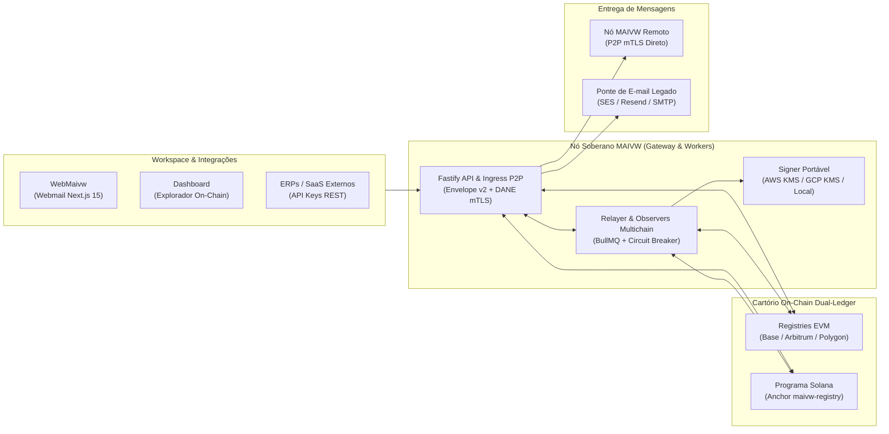

<p align="center">
  <a href="https://maivw.com" target="_blank" rel="noopener noreferrer">
    
  </a>
</p>

<h1 align="center">MAIVW Protocol</h1>

<p align="center">
  <strong>Mathematical Authenticated Identity &amp; Verifiable Workspace</strong>
</p>

<p align="center">
  O protocolo aberto e multichain de comunicação assíncrona corporativa — unindo identidade ancorada on-chain em <strong>EVM (Base, Arbitrum, Polygon)</strong> e <strong>Solana</strong>, transporte P2P soberano com mTLS DANE e interoperabilidade híbrida com o e-mail tradicional.
</p>

<p align="center">
  🌐 <a href="README.md">English</a> | <strong>Português (Brasil)</strong>
</p>

<p align="center">
  <a href="https://docs.maivw.com"></a>
  <a href="https://app.maivw.com"></a>
  <a href="https://www.youtube.com/watch?v=6uFptIQzlBI"></a>
  <a href="https://donate.stripe.com/cNi7sKeUIb5P96deZk2kw00"></a>
</p>

<p align="center">
  
  
  
  
  
  
  
  <a href="LICENSE"></a>
</p>

---

## 🎬 Vídeo de Apresentação

Assista à explicação completa de como o MAIVW substitui a fragilidade do e-mail legado por identidade verificável on-chain e roteamento P2P criptográfico:

<p align="center">
  <a href="https://www.youtube.com/watch?v=6uFptIQzlBI" target="_blank" rel="noopener noreferrer">
    
  </a>
</p>

<p align="center">
  🇧🇷 <strong><a href="https://www.youtube.com/watch?v=6uFptIQzlBI">Assistir em Português (YouTube)</a></strong> &nbsp;|&nbsp;
  🌐 <strong><a href="https://www.youtube.com/watch?v=nizLF3wB8TM">Watch in English (YouTube)</a></strong>
</p>

---

## 💡 O que é o MAIVW?

O **MAIVW** é a sigla oficial para **Mathematical Authenticated Identity & Verifiable Workspace**. Trata-se de uma infraestrutura aberta de comunicação descentralizada projetada para devolver às organizações o controle soberano sobre suas identidades digitais, reputação de domínio e mensagens assíncronas:

- **M — Mathematical (Matemática):** Autoria, integridade e não-repúdio garantidos por provas determinísticas (*secp256k1* / *Ed25519*), árvores de Merkle para lotes de intenção e formato canônico **Envelope v2**.
- **A — Authenticated (Autenticada):** Todas as mensagens são assinadas digitalmente na origem pela chave autorizada do domínio, eliminando matematicamente spoofing, phishing de falsificação de remetente e adulteração em trânsito.
- **I — Identity (Identidade):** O domínio corporativo DNS é ancorado criptograficamente em registros on-chain em **EVM (Base, Arbitrum, Polygon)** ou **Solana**, eliminando a dependência de autoridades centralizadas.
- **V — Verifiable (Verificável):** Qualquer nó valida autonomamente chaves públicas, impressões digitais de certificados TLS (DANE on-chain), stake econômico e status de reputação diretamente contra o estado finalizado da blockchain.
- **W — Workspace (Espaço de Trabalho):** Uma suíte completa e auto-hospedável contendo Webmail corporativo isolado em sandbox (`webmaivw`), administração multitenant de domínios/caixas e painel de observabilidade on-chain em tempo real (`dashboard`).

---

## 🎯 O Problema que Resolvemos

O ecossistema tradicional de e-mails (SMTP/IMAP) foi concebido na década de 1980 sem camadas nativas de autenticidade ou garantias criptográficas de transporte:

1. **Vulnerabilidade Estrutural a Phishing e Spoofing:** Camadas corretivas adicionadas décadas depois (`SPF`, `DKIM`, `DMARC`) são frágeis, frequentemente mal configuradas e não oferecem garantia matemática ponta a ponta nem responsabilização econômica (*skin in the game*).
2. **Oligopólio e Aprisionamento (*Vendor Lock-in*):** Poucas Big Techs controlam quem consegue entregar mensagens e definem arbitrariamente a reputação por meio de algoritmos fechados (*black-boxes*) e bloqueios unilaterais.
3. **Perda de Soberania de Dados:** Empresas pagam caro por assento para armazenar comunicações estratégicas em nuvens de terceiros sujeitas a varreduras automatizadas e jurisdições externas.

**O propósito do MAIVW** é transformar a comunicação corporativa em uma rede P2P aberta, auditável e protegida por criptografia e stake on-chain — mantendo **100% de compatibilidade** com destinatários de e-mail tradicional por meio de sua ponte híbrida SMTP.

---

## ⚡ Como Aderir ao Protocolo

O MAIVW foi desenhado para atender desde empresas que buscam adoção imediata sem gerência de infraestrutura até organizações que exigem operação 100% soberana em servidores próprios.

### Opção 1: MAIVW Cloud (Imediato & Totalmente Gerenciado)
Conecte seu domínio ao protocolo em minutos sem precisar gerenciar servidores, bancos de dados, filas ou nós RPC:

1. Acesse **[app.maivw.com](https://app.maivw.com)**.
2. Verifique a titularidade do seu domínio corporativo via desafio DNS `TXT`.
3. Escolha sua rede de origem canônica (Base ou Solana) e comece a enviar e receber mensagens assinadas imediatamente pelo Webmail moderno.

### Opção 2: Nó Soberano Próprio (Self-Hosted via Docker Compose)
Opere seu próprio nó completo de forma 100% independente em sua máquina, VPS ou nuvem privada.

#### A. Demonstração Local Zero-Config (Stack Anvil Instantânea)
Suba toda a pilha localmente (blockchain EVM local Anvil, deploy automático dos contratos Registry, PostgreSQL, Redis, Gateway, Webmail e Dashboard) com um único comando:

```bash
# 1. Clone o repositório
git clone https://github.com/SilvioSLN/maivw-protocol.git
cd maivw-protocol

# 2. Inicie a pilha local completa
docker compose up -d --build
```

Após a inicialização, acesse em seu navegador:
- **Dashboard de Observabilidade:** `http://localhost:50443`
- **Gateway REST & Nó P2P:** `http://localhost:51443`
- **WebMaivw (Webmail Corporativo & Admin):** `http://localhost:52443`
- **RPC Anvil Local:** `http://localhost:55443`

> **Token de Convite da Demo Local:** Utilize `local-demo-admin-invite-change-before-testnet-2026` ao criar a primeira conta de administrador no ambiente de demonstração.

#### B. Operação em Testnet Pública / Produção
Para conectar seu nó às redes públicas (Base Sepolia, Arbitrum Sepolia, Polygon Amoy e/ou Solana Devnet):

```bash
cp .env.testnet.example .env.testnet
cp contracts/deployments/testnets.example.json contracts/deployments/testnets.json
cp solana/deployments/devnet.example.json solana/deployments/devnet.json
```

Preencha seus endpoints RPC/WS, endereços dos contratos Registry, domínios HTTPS públicos e segredos exclusivos em `.env.testnet`, e inicie a stack:

```bash
docker compose -f compose.testnet.yml --env-file .env.testnet up -d --build
```

Consulte o **[Guia de Instalação Docker e Self-Hosting](https://docs.maivw.com/users/quickstart-docker/)** para detalhes sobre certificados TLS/mTLS, armazenamento S3/Cloudflare R2 e signers em AWS KMS / GCP KMS.

---

## 🧱 Arquitetura e Componentes



### Estrutura do Repositório

```text
maivw-protocol/
├── contracts/     # Solidity 0.8.28 (Foundry): MAIVWRegistry (UUPS), MAIVWMirrorRegistryV2, Lens e codecs EIP-712/V1
├── solana/        # Rust / Anchor 1.0: programa maivw-registry e crate maivw-attestation (stake SPL, Ed25519/secp256k1)
├── gateway/       # Nó Fastify 5 TypeScript: roteador P2P mTLS, adaptadores Dual-Ledger, workers BullMQ, KMS e Prisma
├── webmaivw/      # Webmail corporativo soberano Next.js 15, visualizador sandboxed, proxy anti-SSRF e wizard DNS
├── dashboard/     # Painel Next.js 15 de observabilidade, Cartório On-Chain público e monitor de reputação/slashing
├── docs/          # Documentação técnica Astro Starlight e planejador interativo de arquitetura
├── specs/         # Especificações formais do protocolo (StateAttestationV1, catálogo de origem multichain e codecs)
└── integration/   # Scripts de verificação e testes de integração entre camadas
```

---

## 🛡️ Estágio de Desenvolvimento & Próximos Passos

O protocolo MAIVW encontra-se em estágio de **Testnet Pública & Rollout de Pilotos Controlados**. Toda a arquitetura multichain (EVM + Solana), sincronização de espelhos e endurecimento de runtime estão implementados e cobertos por **446 testes automatizados**:

### Marcos Concluídos
- [x] **Envelope v2 Canônico & Proteção Anti-Replay:** Assinatura determinística (`EIP-191` / `Ed25519`) com classes de mensagem (`TX_CODE`, `TX_RECEIPT`, `SUPPORT`, `CONVERSATION`, `MARKETING`, `COLD_OUTREACH`), controle de nonce e janela temporal.
- [x] **Ancoragem On-Chain DANE & mTLS Fail-Closed (S08):** Validação mTLS ponta a ponta com impressões digitais SHA-256 de certificados ancoradas diretamente no contrato `MAIVWRegistry`.
- [x] **Arquitetura Multichain Dual-Ledger (EVM + Solana):** Registro de origem canônica em **Base**, **Arbitrum**, **Polygon** ou **Solana**, com replicação determinística de estado entre famílias de redes via `StateAttestationV1` (`MAIVWMirrorRegistryV2` em EVM e PDAs `maivw-registry` na Solana).
- [x] **Economia de Stake, Slashing e Recuperação Soberana:** Tiers de provedores on-chain, disputas de slashing com provas de Merkle, rotação de administrador em duas etapas, recuperação emergencial com timelock e reciclagem de domínios expirados (*reclaim*).
- [x] **Endurecimento de Runtime para Produção & Nuvem:** Separação de responsabilidades em workers dedicados (`api`, `p2p`, `mail-worker`, `oracle-worker`, `relayer-worker`, `evm-indexer`, `solana-indexer`), signers não-exportáveis em **AWS KMS** (`secp256k1` e `Ed25519`) e **GCP KMS**, circuit breakers persistentes, armazenamento S3/R2, isolamento estrito multitenant e imagens Docker multi-arquitetura (`linux/amd64`, `linux/arm64`) sem root.

### Próximos Passos no Roadmap
- [ ] **S07 — Criptografia de Ponta a Ponta no Cliente (E2EE):** Acordo de chaves no cliente para confidencialidade zero-knowledge do corpo das mensagens.
- [ ] **Auditoria Externa Independente de Smart Contracts e Programa Anchor:** Revisão formal por auditoria especializada dos contratos em `contracts/` e `solana/programs/maivw-registry` antes do lançamento em Mainnet.
- [ ] **Quórum Descentralizado de Oráculos (`t-of-n`):** Atestação com múltiplos operadores independentes para retransmissão de estado cross-chain com confiança minimizada.
- [ ] **Lançamento Mainnet (GA) & SDKs Oficiais:** Deploy canônico em Base Mainnet e Solana Mainnet acompanhado de pacotes `@maivw/sdk` para integração rápida.

---

## 🧪 Executando as Suítes de Teste

```bash
# 1. Suíte de testes unitários e de integração do Gateway (254 testes)
cd gateway && pnpm test

# 2. Workspace Rust da Solana e vetores normativos (66 testes)
cd solana && cargo test --workspace --locked

# 3. Smart Contracts Solidity EVM via Foundry (126 testes)
cd contracts && forge test --summary

# 4. Consistência de rotas e build estático da documentação
cd docs && pnpm check:docs && pnpm build
```

---

## 🤝 Como Contribuir & Governança

Contribuições da comunidade, relatos de bugs e revisões de segurança são muito bem-vindos! Consulte nossos guias oficiais antes de abrir um Pull Request:

- **[Guia de Contribuição (`CONTRIBUTING.md`)](CONTRIBUTING.md)** — Configuração do ambiente local, padrões de código e fluxo de PR.
- **[Política de Segurança (`SECURITY.md`)](SECURITY.md)** — Divulgação responsável de vulnerabilidades e política de *Safe Harbor*.
- **[Código de Conduta (`CODE_OF_CONDUCT.md`)](CODE_OF_CONDUCT.md)** — Padrões de convivência da comunidade (*Contributor Covenant v2.1*).

---

## 💙 Apoie o Desenvolvimento

O MAIVW Protocol é uma iniciativa de código aberto dedicada à soberania digital corporativa. O desenvolvimento contínuo de contratos multichain, auditorias de segurança e ferramentas públicas é fortalecido pelo apoio da comunidade:

👉 **[Contribua com a evolução do protocolo via Stripe](https://donate.stripe.com/cNi7sKeUIb5P96deZk2kw00)**

---

## 📚 Documentação & Links Oficiais

- 📖 **Documentação Técnica Oficial:** [https://docs.maivw.com](https://docs.maivw.com)
- 🌐 **Plataforma Gerenciada (MAIVW Cloud):** [https://app.maivw.com](https://app.maivw.com)
- 🎬 **Vídeo de Apresentação (Português):** [YouTube (PT-BR)](https://www.youtube.com/watch?v=6uFptIQzlBI)
- 🎬 **Overview Video (English):** [YouTube (EN)](https://www.youtube.com/watch?v=nizLF3wB8TM)
- 💳 **Doações e Patrocínio:** [Link Seguro Stripe](https://donate.stripe.com/cNi7sKeUIb5P96deZk2kw00)

---

## 📄 Licença & Proteção de Marca

O código-fonte deste repositório é distribuído sob a **[Licença MIT](LICENSE)** (`SPDX-License-Identifier: MIT`).

> **Aviso de Marca Registrada (Trademark Notice):** O nome **MAIVW**, suas marcas nominativas, domínios oficiais (`maivw.com`, `app.maivw.com`, `docs.maivw.com`) e logotipos oficiais são propriedade exclusiva dos autores do projeto e **não** estão incluídos na concessão da Licença MIT. Consulte o [Aviso Adicional no arquivo `LICENSE`](LICENSE) para mais detalhes.
